# E-Cell JMI — Admin Panel Documentation & Architectural Guide

This document provides a comprehensive technical breakdown of the **Society Website Admin Panel** built for the Entrepreneurship Cell (E-Cell), Jamia Millia Islamia. It details every created file, explains how Better Auth and Server Actions operate under the hood, outlines end-to-end user and data workflows, and concludes with an interactive Mermaid data flow diagram.

---

## 1. System Overview & Technology Stack

The admin portal is a fully integrated, zero-external-backend administrative suite designed to operate natively within the Next.js App Router.

- **Framework**: Next.js 16.4.0 (App Router, Turbopack, Cache Components, React 19)
- **Language**: TypeScript (Strict typing across schema, actions, and UI)
- **Database**: PostgreSQL hosted on Neon Serverless Postgres
- **ORM**: Prisma Client 7.10.0 with `@prisma/adapter-pg` driver adapter
- **Authentication**: Better Auth 1.7.x (Session cookies, password hashing, and user store)
- **Access Control**: Strict `ADMIN_EMAILS` environment variable whitelist with first-time password initialization.
- **Styling**: Tailwind CSS v4 + Vanilla theme tokens (Deep dark mode `#070606`, warm amber/orange `#f97316` glowing accents, Montserrat typography headings, Nunito Sans body)

---

## 2. Inventory & Detailed Explanation of Every Created File

### A. Authentication & Security Layer

#### 1. [`lib/auth.ts`](file:///Users/akibraza/Desktop/Society/e-cell/lib/auth.ts)
- **Role**: The centralized Better Auth server instance and security guard.
- **How it works**:
  - Connects to Neon PostgreSQL using `new Pool({ connectionString: process.env.DATABASE_URL })`.
  - Configures the `emailAndPassword` authentication provider with salt-hashing.
  - **`isAllowedAdminEmail(email)`**: Validates incoming emails against `process.env.ADMIN_EMAILS` (comma-separated list).
  - **`adminEmailGuardMiddleware` (`createAuthMiddleware`)**: Intercepts `/sign-in/email` and `/sign-up/email`. Any request with an unlisted email is rejected immediately with a `403 FORBIDDEN` error.
  - **`databaseHooks.user.create.before`**: A secondary database-level barrier that blocks creation of any user record whose email is not on the whitelist.
  - Exposes the typed `auth` singleton along with `$Infer.Session` types used across server actions and handlers.

#### 2. [`lib/auth-client.ts`](file:///Users/akibraza/Desktop/Society/e-cell/lib/auth-client.ts)
- **Role**: The browser-side Better Auth React client.
- **How it works**:
  - Initializes `createAuthClient` with the application's origin URL (`process.env.NEXT_PUBLIC_APP_URL` or `window.location.origin`).
  - Exports lightweight client hooks and authentication functions: `signIn`, `signUp`, `signOut`, and `useSession`.
  - Communicates directly with the API route handler without reloading the page.

#### 3. [`app/api/auth/[...all]/route.ts`](file:///Users/akibraza/Desktop/Society/e-cell/app/api/auth/%5B...all%5D/route.ts)
- **Role**: Better Auth App Router HTTP gateway.
- **How it works**:
  - Uses `toNextJsHandler(auth)` to convert Better Auth’s internal REST router into Next.js App Router `GET` and `POST` handlers.
  - Automatically handles endpoints like `/api/auth/sign-in/email`, `/api/auth/sign-up/email`, `/api/auth/sign-out`, and `/api/auth/get-session`.

#### 4. [`lib/admin-auth.ts`](file:///Users/akibraza/Desktop/Society/e-cell/lib/admin-auth.ts)
- **Role**: Server-side session verification, whitelist gatekeeper, and status checker.
- **How it works**:
  - **`getAdminSession()`**: Inspects incoming request headers using Next.js `headers()`, verifies the session token against PostgreSQL via `auth.api.getSession({ headers })`, and returns the active user session or `null`.
  - **`requireAdminSession()`**: A blocking gatekeeper. If no session exists OR if the session user's email is no longer on the `ADMIN_EMAILS` whitelist, it immediately triggers Next.js `redirect("/admin/login")`.
  - **`verifyAdminEmailStatus(email)`**: Server action used by the login UI. Verifies if an email is authorized, and checks PostgreSQL to determine if the admin has already set their password or needs to perform first-time setup.

---

### B. Database & Data Models

#### 5. [`prisma/schema.prisma`](file:///Users/akibraza/Desktop/Society/e-cell/prisma/schema.prisma)
- **Role**: Source of truth for database models and relationships.
- **Key Tables Managed**:
  - `user`, `session`, `account`, `verification`: Better Auth identity and session store.
  - `members`: Society team roster (`name`, `slug`, `team`, `role`, `batch`, `faculty`, `Avatar`, `linkedin`, `github`, `email`, `bio`).
  - `event`: Society summits, pitch competitions, and workshops (`title`, `slug`, `category`, dates, duration, venue, description, cover image, registration link, status badges, published toggle).
  - `blogs`: Articles and founder guides (`title`, `slug`, `excerpt`, `content` markdown, `coverImage`, `authorName`, `published`).
  - `startup`: Incubated ventures (`name`, `slug`, `founder`, `category`, `website`, `logo`, `description`, `published`).
  - `admin`: Legacy table preserved for backwards compatibility.

#### 6. [`lib/db.ts`](file:///Users/akibraza/Desktop/Society/e-cell/lib/db.ts)
- **Role**: Prisma Client connection singleton.
- **How it works**:
  - Configures `PrismaClient` using the `@prisma/adapter-pg` driver over a pooled PostgreSQL connection.
  - Preserves the database client on `globalThis` in development mode to avoid leaking connection pools during hot reloads.
  - Safely handles cases where `DATABASE_URL` is undefined during isolated build steps.

---

### C. Server Actions (CRUD Operations)

#### 7. [`lib/actions/members-actions.ts`](file:///Users/akibraza/Desktop/Society/e-cell/lib/actions/members-actions.ts)
- **Functions**:
  - `getMembersList()`: Retrieves all members sorted by `createdAt desc`.
  - `createMember(data)`: Validates admin authorization via `requireAdminSession()`, derives a clean URL slug if omitted, creates the database record, and revalidates cache paths `/admin/members` and `/teams`.
  - `deleteMember(id)`: Verifies admin identity and removes the record by ID.

#### 8. [`lib/actions/events-actions.ts`](file:///Users/akibraza/Desktop/Society/e-cell/lib/actions/events-actions.ts)
- **Functions**:
  - `getEventsList()`: Lists all events.
  - `getEventById(id)`: Fetches an event for the edit form.
  - `createEvent(data)`: Creates a new event record with category, date formatting, and registration links.
  - `updateEvent(id, data)`: Partially updates existing event attributes.
  - `deleteEvent(id)`: Removes the event and revalidates `/admin/events` and `/events`.

#### 9. [`lib/actions/blogs-actions.ts`](file:///Users/akibraza/Desktop/Society/e-cell/lib/actions/blogs-actions.ts)
- **Functions**:
  - `getBlogsList()`: Fetches all published and draft articles.
  - `getBlogById(id)`: Returns full Markdown content and metadata for editing.
  - `createBlog(data)`: Saves new blog posts with author byline and excerpt.
  - `updateBlog(id, data)`: Updates blog attributes.
  - `deleteBlog(id)`: Removes article and invalidates public cache paths.

#### 10. [`lib/actions/startups-actions.ts`](file:///Users/akibraza/Desktop/Society/e-cell/lib/actions/startups-actions.ts)
- **Functions**:
  - `getStartupsList()`: Lists all incubated startup profiles.
  - `getStartupById(id)`: Returns venture details for editing.
  - `createStartup(data)`: Inserts new startup record (name, category, founder, logo, thesis).
  - `updateStartup(id, data)`: Updates venture details.
  - `deleteStartup(id)`: Deletes listing and revalidates `/admin/startups` and `/startup`.

---

### D. Admin UI Layout & Authentication Pages

#### 11. [`app/admin/layout.tsx`](file:///Users/akibraza/Desktop/Society/e-cell/app/admin/layout.tsx)
- **Role**: Root wrapper for the administrative area.
- **Features**:
  - Establishes the website theme’s ambient orange/amber blurred radial glow.
  - Reads active session to pass user details to the navigation bar.
  - Declares `export const instant = false;` to seamlessly integrate with Next.js 16 Cache Components and allow dynamic request-time authorization.

#### 12. [`components/admin/admin-nav.tsx`](file:///Users/akibraza/Desktop/Society/e-cell/components/admin/admin-nav.tsx)
- **Role**: Top navigation bar for the admin portal.
- **Features**:
  - Displays E-Cell society badge with glowing "Admin" pill.
  - Navigation tabs (Overview, Members, Events, Blogs, Startups) with active link indicators.
  - Quick link to the public website (`/`).
  - Shows logged-in admin email.
  - Integrated `handleSignOut()` button calling `signOut()` from Better Auth client.
  - Automatically hides on the `/admin/login` route.

#### 13. [`app/admin/login/page.tsx`](file:///Users/akibraza/Desktop/Society/e-cell/app/admin/login/page.tsx)
- **Role**: Secure login and admin registration interface.
- **Features**:
  - Centered dark card with glowing border and lock icon badges.
  - Dual mode: "Sign In" vs "Create Administrator Account" (for initial bootstrapping).
  - Calls Better Auth `signIn.email()` or `signUp.email()`.
  - Handles validation errors, loading spinners, and redirects to `/admin` upon success.

#### 14. [`app/admin/page.tsx`](file:///Users/akibraza/Desktop/Society/e-cell/app/admin/page.tsx)
- **Role**: Executive dashboard overview.
- **Features**:
  - Welcome banner displaying administrator name.
  - Four metrics cards reporting live counts from PostgreSQL for Members, Events, Blogs, and Startups.
  - Quick action shortcuts (e.g., "+ Create Event", "+ Add Member").
  - Live Neon PostgreSQL status indicator.

---

### E. Module 1: Members Management

#### 15. [`app/admin/members/page.tsx`](file:///Users/akibraza/Desktop/Society/e-cell/app/admin/members/page.tsx)
- Server component that calls `requireAdminSession()`, loads members via `getMembersList()`, and renders `MembersManager`.

#### 16. [`components/admin/members-manager.tsx`](file:///Users/akibraza/Desktop/Society/e-cell/components/admin/members-manager.tsx)
- Client-side interactive directory:
  - Real-time search across names, roles, departments, and faculties.
  - Department filter tabs (`Core Team`, `Technical`, `Operations`, `Design`, `Media`, `PR`).
  - "Add Member" modal dialog with validation for avatar, social links, and tenure batch.
  - Two-step deletion confirmation to prevent accidental removals.
  - Clickable links to public profiles (`/teams/[slug]`), LinkedIn, GitHub, and email.

---

### F. Module 2: Events Management

#### 17. [`app/admin/events/page.tsx`](file:///Users/akibraza/Desktop/Society/e-cell/app/admin/events/page.tsx)
- Server page fetching event records and passing them to `EventsManager`.

#### 18. [`components/admin/events-manager.tsx`](file:///Users/akibraza/Desktop/Society/e-cell/components/admin/events-manager.tsx)
- Interactive event list with:
  - Status filters (`All`, `Upcoming`, `Live Now`, `Completed`).
  - Search by event title, venue, and category.
  - Status badges, date/time chips, venue indicators, and published/draft badges.
  - Edit link, deletion confirmation, and external ticket/registration links.

#### 19. [`components/admin/event-form.tsx`](file:///Users/akibraza/Desktop/Society/e-cell/components/admin/event-form.tsx)
- Reusable event authoring form used by both creation and update routes:
  - Full scheduling details: month, day of week, day number, year, display time, venue.
  - Category selector (Flagship Summit, Pitch Competition, Workshop, Hackathon, Founder Meetup).
  - Registration URL and cover poster URL.
  - Published checkbox and status badge selector.

#### 20. [`app/admin/events/new/page.tsx`](file:///Users/akibraza/Desktop/Society/e-cell/app/admin/events/new/page.tsx) & [`app/admin/events/[id]/page.tsx`](file:///Users/akibraza/Desktop/Society/e-cell/app/admin/events/%5Bid%5D/page.tsx)
- Dedicated routes for adding and editing events. Resolves dynamic async route params in Next.js 16 (`const { id } = await params;`).

---

### G. Module 3: Blogs Management

#### 21. [`app/admin/blogs/page.tsx`](file:///Users/akibraza/Desktop/Society/e-cell/app/admin/blogs/page.tsx)
- Server page fetching all articles and passing them to `BlogsManager`.

#### 22. [`components/admin/blogs-manager.tsx`](file:///Users/akibraza/Desktop/Society/e-cell/components/admin/blogs-manager.tsx)
- Editorial management view:
  - Thumbnail preview, title, author byline, and excerpt.
  - Search filter across titles and author names.
  - Edit action, delete confirmation, and direct link to public blogs view (`/blogs`).

#### 23. [`components/admin/blog-form.tsx`](file:///Users/akibraza/Desktop/Society/e-cell/components/admin/blog-form.tsx)
- Article editor with:
  - Dual-mode Markdown authoring (Interactive "Write" and "Preview" tabs).
  - Auto-generated slug based on title.
  - Excerpt and cover image inputs.
  - Immediate publication toggle.

#### 24. [`app/admin/blogs/new/page.tsx`](file:///Users/akibraza/Desktop/Society/e-cell/app/admin/blogs/new/page.tsx) & [`app/admin/blogs/[id]/page.tsx`](file:///Users/akibraza/Desktop/Society/e-cell/app/admin/blogs/%5Bid%5D/page.tsx)
- Creation and edit route endpoints.

---

### H. Module 4: Startups Management

#### 25. [`app/admin/startups/page.tsx`](file:///Users/akibraza/Desktop/Society/e-cell/app/admin/startups/page.tsx)
- Server page loading incubated ventures into `StartupsManager`.

#### 26. [`components/admin/startups-manager.tsx`](file:///Users/akibraza/Desktop/Society/e-cell/components/admin/startups-manager.tsx)
- Portfolio showcase manager:
  - Grid of startup cards showing company logo, name, founder, category badge, and pitch description.
  - External link to the startup's live website.
  - Edit and delete actions with confirmation prompts.

#### 27. [`components/admin/startup-form.tsx`](file:///Users/akibraza/Desktop/Society/e-cell/components/admin/startup-form.tsx)
- Venture registration form:
  - Startup name, custom/auto slug, founder names.
  - Industry selector (AI & DeepTech, CleanTech, Autonomous Tech, Fintech, EdTech, HealthTech).
  - Website URL and logo asset link.
  - Startup thesis / problem statement textarea.
  - Published toggle.

#### 28. [`app/admin/startups/new/page.tsx`](file:///Users/akibraza/Desktop/Society/e-cell/app/admin/startups/new/page.tsx) & [`app/admin/startups/[id]/page.tsx`](file:///Users/akibraza/Desktop/Society/e-cell/app/admin/startups/%5Bid%5D/page.tsx)
- Creation and edit route endpoints.

---

## 3. How Better Auth & Security Work

```
Browser Client                    Next.js API Gateway                Neon PostgreSQL
 [Login Form]                      [/api/auth/*]                     [Database Pool]
      │                                  │                                  │
      ├── 1. Check ADMIN_EMAILS list ────►│ (Pre-validation check)           │
      │   (Unlisted emails rejected)     │                                  │
      ├── 2. First-time or Sign-in? ─────►│ Query existing user in DB ──────►│
      │   (Sets password or logs in)     │◄── Return status ────────────────┤
      ├── 3. submit (email + password) ──►│                                  │
      │                                  ├── 4. Verify password & create   │
      │                                  │      session token in `session` ─►│
      │                                  │◄── 5. Session saved ─────────────┤
      │◄── 6. Set HTTP-Only Cookie ──────┤                                  │
      │       (better-auth.session_token)│                                  │
```

1. **Environment Whitelist (`ADMIN_EMAILS`)**:
   - Only emails explicitly listed in `process.env.ADMIN_EMAILS` (comma-separated, e.g. `admin@ecelljmi.com,akib2505658@st.jmi.ac.in`) can access or register.
   - Any attempt by unlisted emails to sign in or register is rejected immediately by the server middleware with a `403 FORBIDDEN` error.

2. **First-Time Password Setup & Permanent Login**:
   - When an authorized email visits the portal for the first time, they switch to the **"First-Time Setup"** tab and choose their password.
   - The system creates their user record and cryptographic password hash in Neon PostgreSQL.
   - Once created, that email can **only** log in using that established password on the **"Sign In"** tab.
   - Any future attempts to re-register or run setup for an existing email are blocked.
   - **No Forgot Password Flow**: Per society administrative security guidelines, password resets are not exposed publicly, preventing credential hijacking.

3. **Multi-Tier Route & Mutation Protection**:
   - **Page Access**: `requireAdminSession()` verifies the session token and re-verifies that `isAllowedAdminEmail(session.user.email)` is true. If an email is ever removed from `ADMIN_EMAILS`, their access is immediately revoked.
   - **Server Actions**: Every mutating server action begins with `await requireAdminSession()`.

---

## 4. How Server Actions Work with Prisma & Revalidation

When an administrator performs an action (e.g. creating an event or deleting a member):

1. **Client Trigger**:
   - The client component calls the server action (e.g. `createMember(data)`).
2. **Server Execution**:
   - The action verifies credentials on the server using `requireAdminSession()`.
   - The action sanitizes inputs, builds URL slugs, and uses `prisma[model].create()` or `update()` to persist the change in Neon PostgreSQL.
3. **Instant Cache Revalidation**:
   - The action calls `revalidatePath("/admin/...")` and `revalidatePath("/[public-route]")`.
   - Next.js immediately purges the static cache for that route so both the administrative dashboard and the public visitors see the updated data instantly.

---

## 5. End-to-End Data Flow Diagram

```mermaid
flowchart TD
    subgraph Client ["Client Browser (Society Website & Admin Portal)"]
        UI_AdminLogin["Admin Login (/admin/login)"]
        UI_Dashboard["Admin Dashboard (/admin)"]
        UI_Members["Members Manager (/admin/members)"]
        UI_Events["Events Manager (/admin/events)"]
        UI_Blogs["Blogs Manager (/admin/blogs)"]
        UI_Startups["Startups Manager (/admin/startups)"]
        UI_Public["Public Visitor Pages (/teams, /events, /blogs, /startup)"]
    end

    subgraph Auth ["Authentication Gateway (Better Auth)"]
        API_AuthRoute["/api/auth/[...all] Handler"]
        Auth_Verify["Server Verification: requireAdminSession()"]
    end

    subgraph Actions ["Next.js Server Actions Layer"]
        Act_Members["lib/actions/members-actions.ts"]
        Act_Events["lib/actions/events-actions.ts"]
        Act_Blogs["lib/actions/blogs-actions.ts"]
        Act_Startups["lib/actions/startups-actions.ts"]
    end

    subgraph DB ["Neon Serverless PostgreSQL (via Prisma ORM)"]
        Table_User["user / session / account"]
        Table_Members["members Table"]
        Table_Event["event Table"]
        Table_Blogs["blogs Table"]
        Table_Startup["startup Table"]
    end

    subgraph Cache ["Next.js Cache & Revalidation Engine"]
        Reval["revalidatePath()"]
    end

    %% Auth Flow
    UI_AdminLogin -->|1. Enter Email| Auth_Whitelist{"Check ADMIN_EMAILS Whitelist"}
    Auth_Whitelist -->|Unauthorized| UI_Deny["403 Forbidden Alert"]
    Auth_Whitelist -->|Authorized & First Time| UI_Setup["First-Time Setup: Set Password"]
    Auth_Whitelist -->|Authorized & Existing| UI_SignIn["Enter Established Password"]

    UI_Setup -->|2. Create Account & Hash Password| API_AuthRoute
    UI_SignIn -->|2. Verify Credentials| API_AuthRoute

    API_AuthRoute -->|3. Store / Validate Session| Table_User
    API_AuthRoute -->|4. Set Secure Session Cookie| UI_Dashboard

    %% Admin Access & Verification
    UI_Dashboard -->|Check Session| Auth_Verify
    UI_Members -->|Check Session| Auth_Verify
    UI_Events -->|Check Session| Auth_Verify
    UI_Blogs -->|Check Session| Auth_Verify
    UI_Startups -->|Check Session| Auth_Verify
    Auth_Verify -.->|Unauthorized| UI_AdminLogin

    %% Actions Flow
    UI_Members -->|Create / Delete Member| Act_Members
    UI_Events -->|Create / Edit / Delete Event| Act_Events
    UI_Blogs -->|Create / Edit / Delete Blog| Act_Blogs
    UI_Startups -->|Create / Edit / Delete Startup| Act_Startups

    %% DB Mutations
    Act_Members -->|Prisma Query| Table_Members
    Act_Events -->|Prisma Query| Table_Event
    Act_Blogs -->|Prisma Query| Table_Blogs
    Act_Startups -->|Prisma Query| Table_Startup

    %% Revalidation
    Act_Members -->|Trigger Revalidation| Reval
    Act_Events -->|Trigger Revalidation| Reval
    Act_Blogs -->|Trigger Revalidation| Reval
    Act_Startups -->|Trigger Revalidation| Reval

    %% Public Updates
    Reval -->|Update Static Shell & Stream Content| UI_Public
    Table_Members -.-> UI_Public
    Table_Event -.-> UI_Public
    Table_Blogs -.-> UI_Public
    Table_Startup -.-> UI_Public
```



---

## 6. Verification & Production Readiness Summary

- **Compilation**: Turbopack production build verified (`npm run build`) passing with code `0`.
- **Route Matrix**: 23 total routes across public and protected admin paths.
- **Theme Integrity**: Consistent dark mode with custom radial gradients, glassmorphism, responsive navigation, and accessible interactive states.
